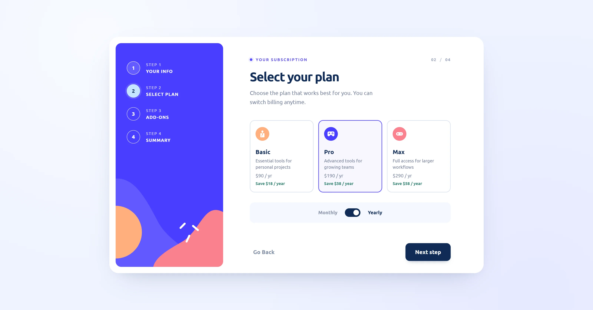
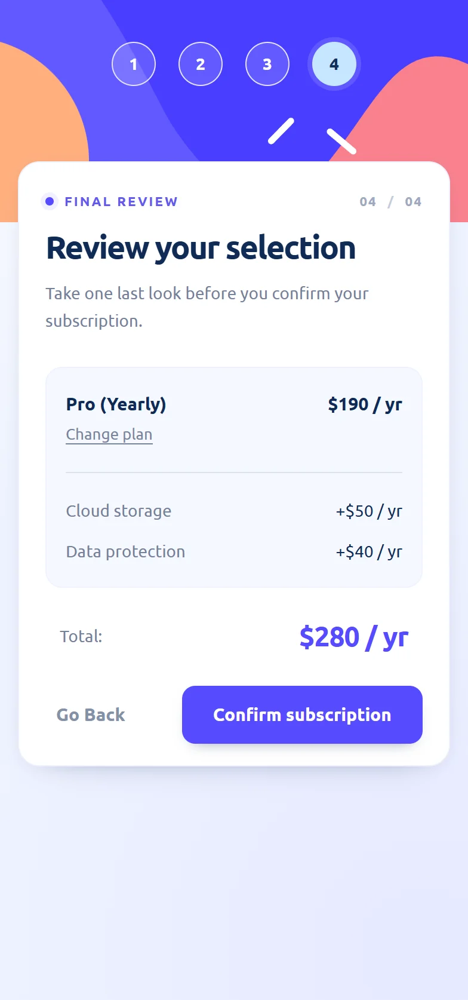

# Multi-Step Subscription Form

A responsive, four-step subscription form built with **HTML, CSS, and vanilla JavaScript**. It demonstrates client-side validation, interactive plan selection, billing calculations, and a live order summary without a frontend framework.

**[View live demo](https://ikatenev.github.io/multi-step-form/)** · **[Source code](https://github.com/IKatenev/multi-step-form)**

## Preview

[](https://ikatenev.github.io/multi-step-form/)

<p align="center">
  
  
</p>

## How it works

1. **Personal details** — enter a name, email, and phone number, with inline validation.
2. **Select a plan** — choose Basic, Pro, or Max, then switch between monthly and yearly billing. The interface calculates the annual savings.
3. **Add-ons** — select optional services, with prices updated to match the billing period.
4. **Review** — check the selected plan, add-ons, and calculated total; go back to make changes.

A fifth view confirms the end of the demo flow. **No real subscription or payment is created.**

## Frontend features

- **Multi-step navigation:** move forward or backward while preserving selected values.
- **Form validation:** required fields, email and phone checks, and inline error feedback.
- **Dynamic pricing:** monthly/yearly prices and add-ons update with the selected billing period.
- **Live summary:** the final screen calculates a total from the selected plan and add-ons.
- **Structured data:** JavaScript gathers form values into a `formData` object for potential API integration.
- **Responsive UI:** desktop and mobile layouts, with keyboard-operable native inputs, visible focus states, and reduced-motion support.

## Tech stack

**HTML5 · CSS3 (Grid, Flexbox, custom properties) · JavaScript (ES6+) · GitHub Pages**

The project is a lightweight static frontend with no framework, build step, or external runtime dependencies.

## Data and demo limitations

This is a **frontend-only portfolio demo**. The current implementation prepares a JavaScript `formData` object in browser memory without logging contact details to the console. It does not send form values to a server, process payments, or store a subscription. The completion screen explicitly confirms these limitations. Example pricing and contact details are illustrative.

## Run locally

```bash
git clone https://github.com/IKatenev/multi-step-form.git
cd multi-step-form
```

Open `index.html` in your browser, or run a local static server (for example, `python -m http.server 8000`) and visit `http://localhost:8000/`.

## Design attribution

Based on the [Frontend Mentor Multi-step Form challenge](https://www.frontendmentor.io/challenges/multistep-form-YVAnSdqQBJ). The original challenge design and supplied assets are credited to Frontend Mentor. This repository showcases my frontend implementation and adaptations; it is **not a commissioned client project**.
